<p align="center">
  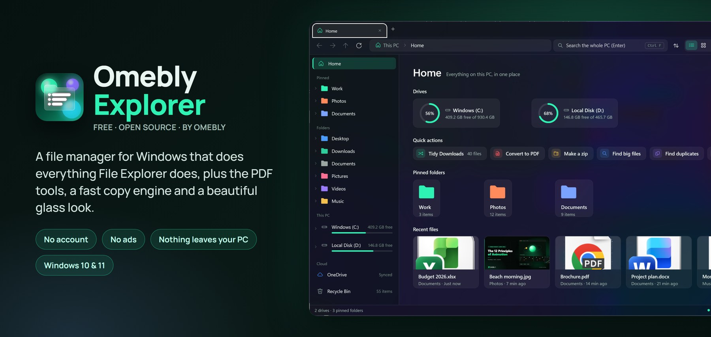
</p>

<p align="center">
  <a href="https://github.com/hussain5049/omebly-explorer/releases/latest/download/OmeblyExplorer-Setup-x64.exe"></a>
  &nbsp;
  <a href="https://github.com/hussain5049/omebly-explorer/releases/latest/download/OmeblyExplorer-Setup-arm64.exe"></a>
</p>

<p align="center">
  <a href="https://github.com/hussain5049/omebly-explorer/releases/latest"></a>
  <a href="https://github.com/hussain5049/omebly-explorer/releases"></a>
  <a href="https://github.com/hussain5049/omebly-explorer/stargazers"></a>
  
  <a href="LICENSE"></a>
</p>

<p align="center">
  <b>Everything File Explorer does, and a lot more.</b><br>
  Tabs, a viewer for every file, 51 PDF tools on the right-click menu, ZIP and 7Z, a copy engine up to 18x faster,<br>
  folder colours, tags, duplicates, a disk space map, bulk rename and a beautiful glass look.<br>
  Free, open source, no account, no ads, and nothing ever leaves your PC.
</p>

<p align="center">
  <a href="https://omebly.com/tools/explorer/">Website and guide</a> ·
  <a href="https://omebly.com/blog/omebly-explorer-free-file-manager-windows/">Why we built it</a> ·
  <a href="#install-it">Install</a> ·
  <a href="#how-to-use-it">How to use it</a> ·
  <a href="#keyboard-shortcuts">Shortcuts</a> ·
  <a href="#questions">Questions</a>
</p>

---

## Contents

1. [Install it](#install-it)
2. [Home](#1-home)
3. [Finding your way around a folder](#2-finding-your-way-around-a-folder)
4. [Tabs and windows](#3-tabs-and-windows)
5. [Opening files without leaving the app](#4-opening-files-without-leaving-the-app)
6. [The right-click menu](#5-the-right-click-menu)
7. [PDF tools](#6-pdf-tools)
8. [ZIP, 7Z, RAR and other archives](#7-zip-7z-rar-and-other-archives)
9. [Copying and moving](#8-copying-and-moving)
10. [Searching](#9-searching)
11. [The command bar](#10-the-command-bar)
12. [Folder colours, tags and other ways to organise](#11-folder-colours-tags-and-other-ways-to-organise)
13. [Renaming many files at once](#12-renaming-many-files-at-once)
14. [Tools: duplicates, disk space, clean-up, compare, rules and backup](#13-tools)
15. [More tools: lock, shred, permissions](#14-more-tools-lock-shred-permissions)
16. [Preview pane and split view](#15-preview-pane-and-split-view)
17. [Cloud drives, phones and servers](#16-cloud-drives-phones-and-servers)
18. [Make Omebly your default file manager](#17-make-omebly-your-default-file-manager)
19. [Themes](#18-themes)
20. [Updates](#19-updates)
21. [Keyboard shortcuts](#keyboard-shortcuts)
22. [Privacy and safety](#privacy-and-safety)
23. [Questions](#questions)
24. [Build it yourself](#build-it-yourself)

---

## Install it

1. **Download** the installer: [OmeblyExplorer-Setup-x64.exe](https://github.com/hussain5049/omebly-explorer/releases/latest/download/OmeblyExplorer-Setup-x64.exe) for most PCs, or the [ARM64 one](https://github.com/hussain5049/omebly-explorer/releases/latest/download/OmeblyExplorer-Setup-arm64.exe) for PCs with a Snapdragon or other ARM processor. Not sure? Open **Settings > System > About** and look at "System type".
2. **Open the file.** Windows may say *"Windows protected your PC"*. That happens with apps that are new and not yet downloaded by many people. Click **More info**, then **Run anyway**.
3. **Click Install.** It installs for your account only, needs no admin password, and adds Omebly Explorer to the Start menu.
4. **Open it.** You're on [Home](#1-home). Everything else is one click from there.

To remove it, go to **Settings > Apps > Installed apps > Omebly Explorer > Uninstall**. If you made Omebly your default file manager, the uninstaller hands your folders back to File Explorer first.

---

## How to use it

### 1. Home

Home is where Omebly Explorer opens. It shows your drives, the folders you pinned, the files you opened lately and one-click actions.

<p align="center">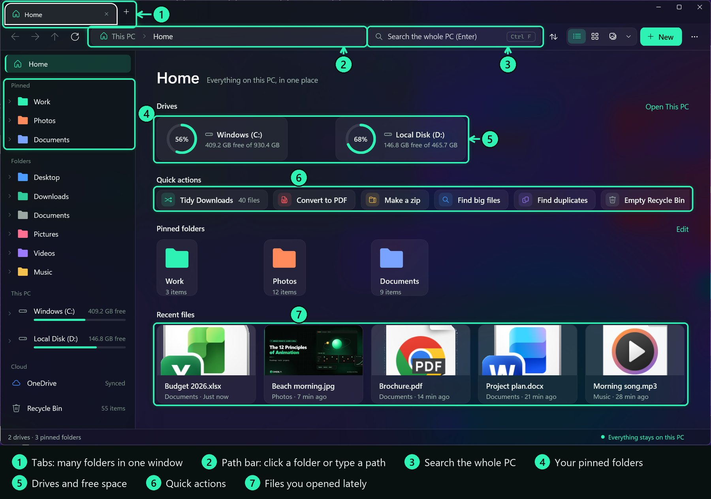</p>

| | What it is | How to use it |
|---|---|---|
| **1** | **Tabs** | Each tab is a folder. Press **Ctrl+T** for a new one and **Ctrl+W** to close it. |
| **2** | **Path bar** | Click any folder name to jump there, or click the empty part (or press **Ctrl+L**) and type a path such as `D:\Work`. |
| **3** | **Search** | On Home it searches the whole PC by name, instantly. Inside a folder it filters what you see; press **Enter** to look inside files too. |
| **4** | **Pinned folders** | Right-click any folder and choose **Pin to Home**. Right-click a pinned folder to unpin it or change its colour. |
| **5** | **Drives** | How full each drive is. Click one to open it. |
| **6** | **Quick actions** | Tidy your Downloads folder, turn files into a PDF, make a ZIP, find big files or duplicates, empty the Recycle Bin. |
| **7** | **Recent files** | The files you opened lately, from any app. You can turn this off in **Folder options**. |

### 2. Finding your way around a folder

<p align="center">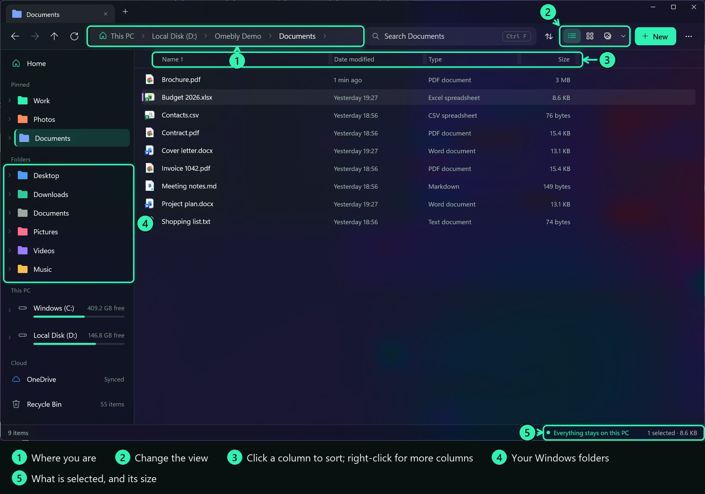</p>

- **Open a folder or file:** double-click it (or select it and press **Enter**). Want one click? Change it in **⋯ > Folder options**.
- **Go back and forward:** the arrows at the top left, **Alt+Left** and **Alt+Right**, **Backspace**, or the side buttons on your mouse. **Alt+Up** goes up one folder.
- **Change the view (2):** Details, List, Tiles, Gallery and four icon sizes. **Ctrl+mouse wheel** changes the size, and each folder remembers its own view.
- **Sort and columns (3):** click a column to sort by it, and click again to reverse the order. Right-click the column header to add any of 24 columns (dimensions, length, artist, date taken and more), and drag the edges to resize. **All views > Group by** groups by type, date, size and other things.
- **Show only some files:** **All views > Show only** keeps just pictures, videos, documents, this week's files and so on.
- **Select:** click, **Ctrl+click** or **Shift+click**, or drag a box around files. **Ctrl+A** selects all.
- **Hidden files and file extensions:** **⋯ > Show hidden files**, and the same for extensions (extensions are shown by default, so `photo.jpg.exe` can't fool you).
- **Status bar (5):** how many items there are, and how many are selected with their total size.

<details>
<summary><b>Gallery view</b>: big pictures for photo folders</summary>
<p align="center">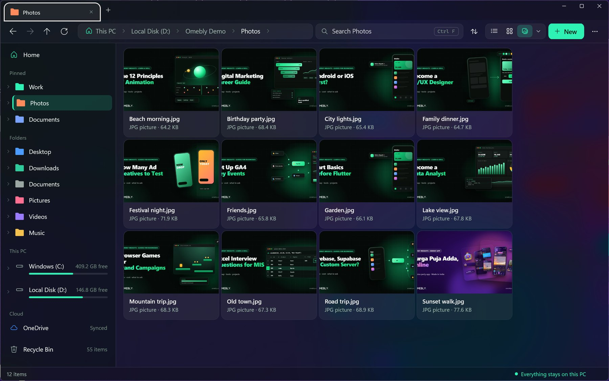</p>
</details>

### 3. Tabs and windows

<p align="center">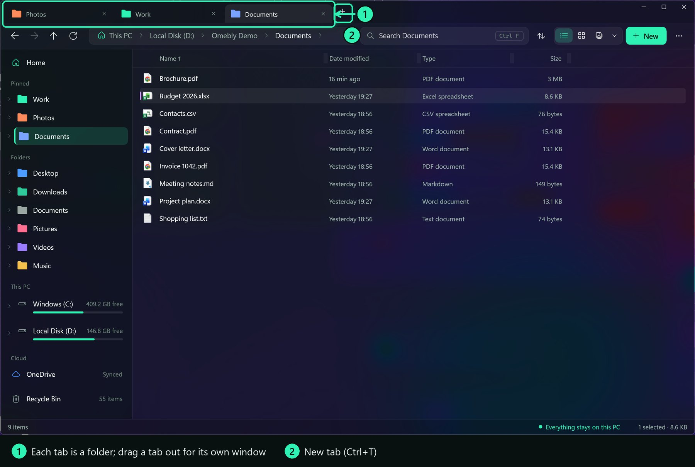</p>

- **New tab (2):** the **+** button or **Ctrl+T**. Middle-click a folder to open it in a new tab.
- **Switch tabs:** click a tab, or press **Ctrl+Tab** and **Ctrl+Shift+Tab**.
- **Its own window:** drag a tab out of the strip. **Ctrl+N** opens a new window.
- **Closed one by mistake?** **Ctrl+Shift+T** brings it back.
- **Workspaces:** save the tabs you have open as a workspace (**All views > Workspaces**) and open the whole set again later in one click.

### 4. Opening files without leaving the app

Double-click a file and it opens in a pop-up viewer inside Omebly Explorer. Press **Space** for a quick look, and **Esc** to close it.

<p align="center">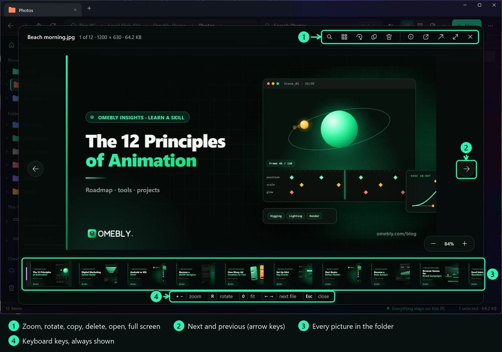</p>

- **Pictures (JPG, PNG, GIF, WebP, HEIC, SVG, BMP, ICO and more):** zoom with **+** and **−** or the mouse wheel, rotate with **R**, and press **0** to fit. The arrow keys (2) go through every picture in the folder, and the strip at the bottom (3) jumps straight to one.
- **The buttons at the top (1):** copy, delete, file info, open in its usual app, pop out into its own window, and full screen.

<p align="center">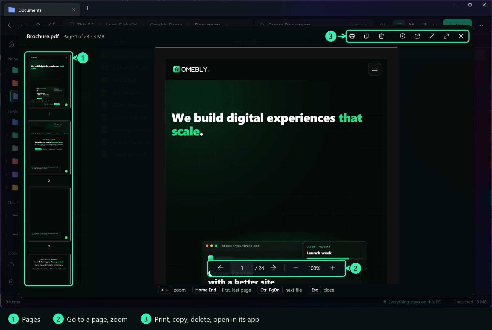</p>

- **PDF:** pages down the side (1), page numbers and zoom (2), print (3). **Home** and **End** go to the first and last page.

<p align="center">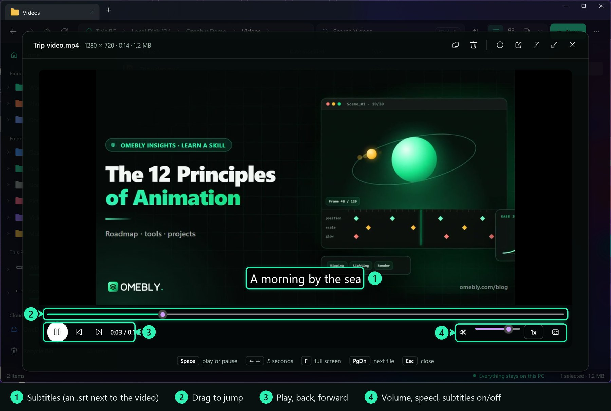</p>

- **Video and music (MP4, MKV, MOV, MP3, WAV, FLAC and more):** **Space** plays and pauses, the arrow keys skip 5 seconds, and **F** is full screen. Put an `.srt` file with the same name next to a video and its subtitles show (1).
- **Word, Excel and PowerPoint:** a read-only preview.
- **Text and code:** text and code are coloured by language. Press **E** to edit, then **Ctrl+S** to save; if you close without saving, it asks.
- **Markdown, CSV and web pages:** Markdown is shown formatted, CSV as a table, and web pages with their scripts turned off for safety.
- **Fonts and archives:** fonts show a sample, and archives show what's inside.
- **Next file:** **Ctrl+Page Down** and **Ctrl+Page Up** go through every file in the folder.

### 5. The right-click menu

Right-click any file or folder. The most useful things are on the first menu, and Windows' own full menu is still there under **Show more options** (5).

<p align="center">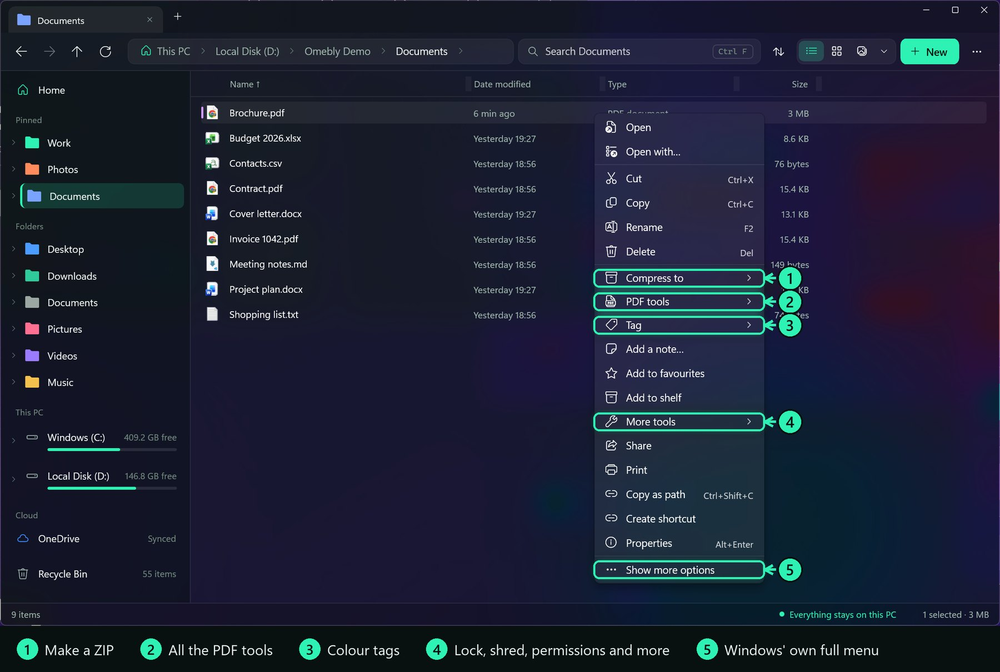</p>

1. **Compress to:** make a ZIP (with a password if you want), a TAR or a TAR.GZ.
2. **PDF tools:** see the [next part](#6-pdf-tools).
3. **Tag:** a colour tag; tagged files are one click away in the sidebar.
4. **More tools:** make a link, see who can open a file, lock with a password, hide, scan with Windows Security, shred.
5. **Show more options:** Windows' classic menu, with everything your other apps added.

Also on the menu: **Open with**, **Cut**, **Copy**, **Rename** (**F2**), **Delete** (**Del**, to the Recycle Bin; **Shift+Del** asks, then deletes for good), **Add a note**, **Add to favourites**, **Add to shelf**, **Share**, **Print**, **Copy as path**, **Create shortcut** and **Properties** (**Alt+Enter**).

### 6. PDF tools

Right-click any PDF (or a Word, Excel, picture or web page file) and choose **PDF tools**. There are 51 tools, sorted into five groups.

<p align="center">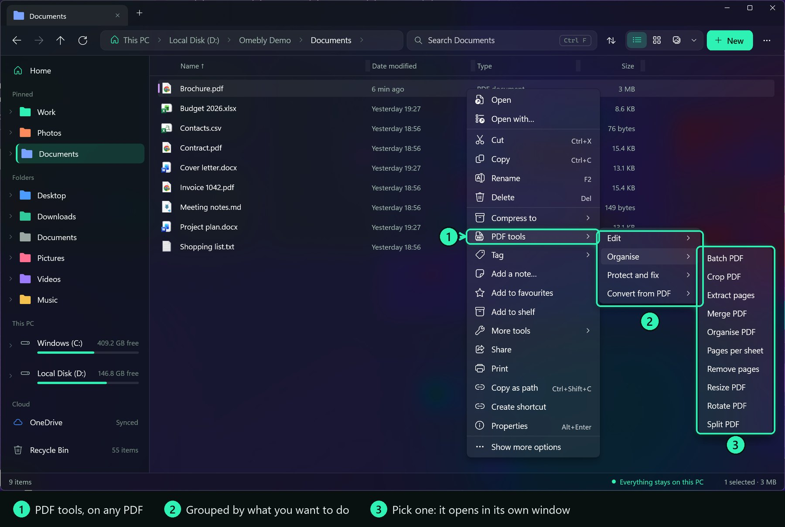</p>

| Group | Tools |
|---|---|
| **Organise** | Merge, split, extract pages, remove pages, organise (reorder), rotate, pages per sheet, resize, crop, batch |
| **Convert from PDF** | PDF to Word, Excel, PowerPoint, JPG, PNG, text, Markdown, EPUB, PDF/A; extract images |
| **Convert to PDF** | Word, Excel, PowerPoint, JPG, any picture, web page, Markdown, text, EPUB, scan to PDF |
| **Edit** | PDF editor, sign, watermark, page numbers, header and footer, Bates numbering, bookmarks, metadata, fill forms, create forms, redact, remove comments, flatten, greyscale |
| **Protect and fix** | Protect with a password, unlock, compress, optimise for the web, repair, OCR (make scans searchable), compare two PDFs |

Pick one and it opens in its own window with your file already loaded:

<p align="center">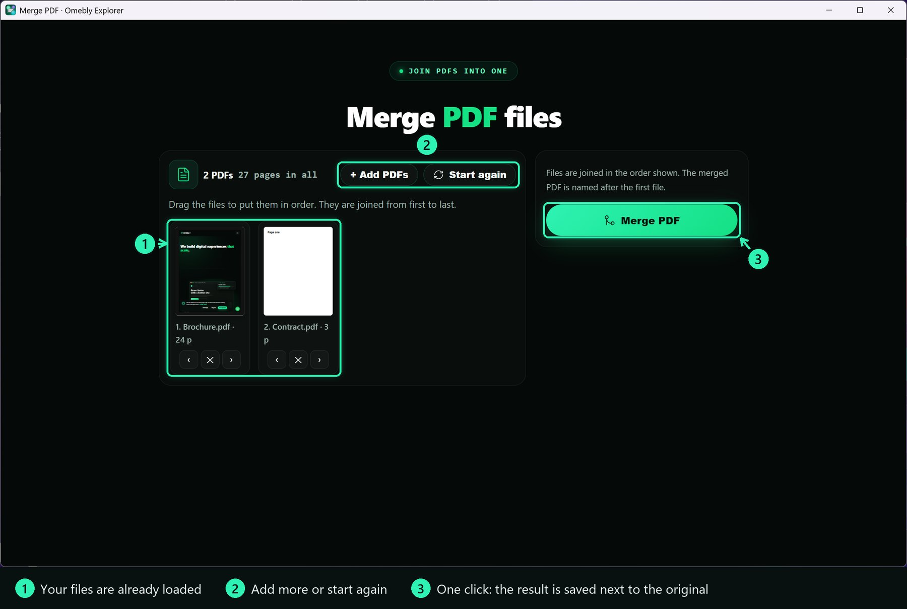</p>

1. Your files are already there. Drag them into the order you want.
2. Add more files, or start again.
3. Click the main button. The result is saved **next to the original**, with a new name, so nothing is ever overwritten. **Ctrl+Z** in Omebly Explorer takes it away again.

The PDF tools run entirely on your PC, even with no internet. No file is uploaded anywhere, and you don't need Microsoft Word or any other app.

### 7. ZIP, 7Z, RAR and other archives

Double-click a ZIP, 7Z, RAR, TAR or GZ file and it opens like a folder.

<p align="center">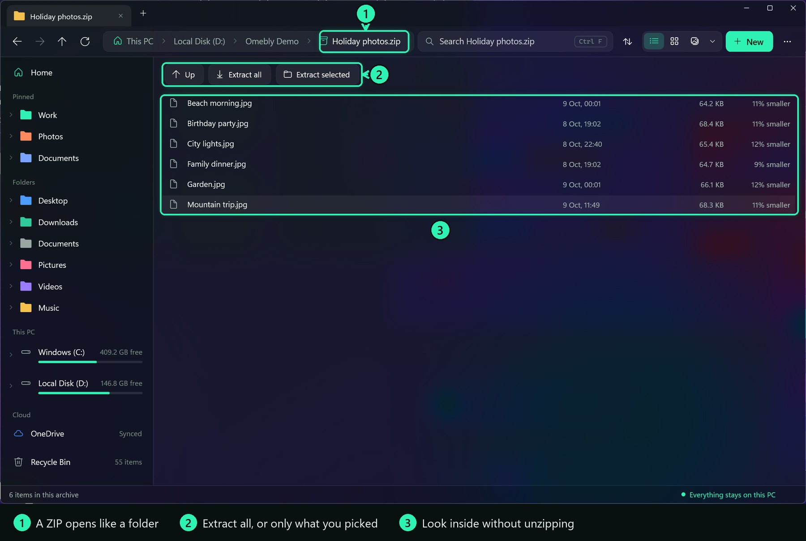</p>

- **Look inside (3):** browse the folders inside, and double-click a file to open it without extracting anything.
- **Extract (2):** **Extract all** or **Extract selected**, or right-click the archive and choose **Extract here** or **Extract to a folder**. Password-protected archives ask for the password.
- **Make one:** select files, right-click, **Compress to > ZIP**, with an optional AES-256 password.
- **Safe by design:** an archive can never write outside the folder you chose, and "zip bombs" (tiny files that expand into terabytes) are stopped.

### 8. Copying and moving

Copy and paste as usual: **Ctrl+C**, **Ctrl+X**, **Ctrl+V**, or drag and drop (hold **Ctrl** to copy, **Shift** to move and **Alt** to make a shortcut). A card shows the progress.

<p align="center">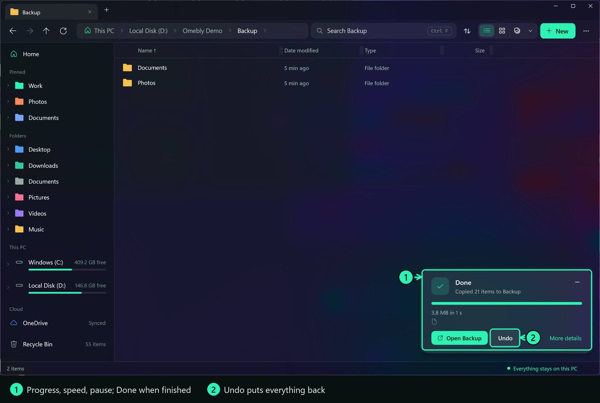</p>

- **The card (1):** speed, time left and the file it's on. You can pause, resume or cancel. After a few seconds it tucks into a small chip in the status bar.
- **Same names:** if files with the same names are already there, it asks once for all of them: **Replace**, **Skip**, **Keep both**, or decide one by one.
- **Undo (2):** puts everything back. **Ctrl+Z** undoes copies, moves, renames, deletes and new folders; **Ctrl+Y** redoes.
- **Fast:** thousands of small files copy up to 18 times faster than in Windows, and big files at full disk speed.

### 9. Searching

<p align="center">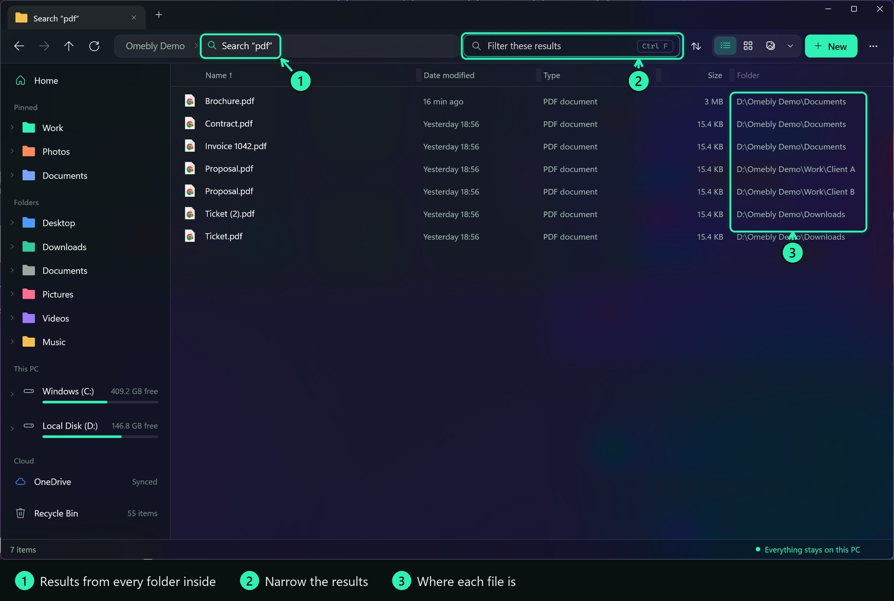</p>

- **In a folder:** type in the search box and the list narrows as you type. Press **Enter** to search this folder and every folder inside it, including **inside** text files, documents and code.
- **The whole PC:** search from Home. Omebly keeps its own index of file names, so results come instantly.
- **In the results:** each file shows where it is (3), and you can narrow them further (2), sort them or right-click them like any other files.

### 10. The command bar

Press **Ctrl+K**, type what you want to do, and press **Enter**. It's the fastest way to anything: change the view, open a pinned folder, turn the preview pane on, switch theme, open Tools, make a ZIP of what you selected, and more.

<p align="center">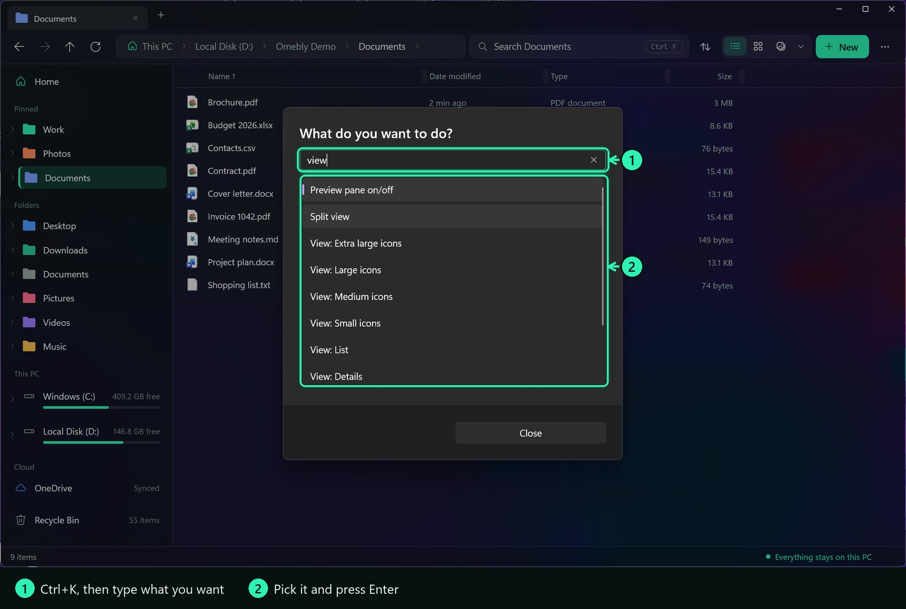</p>

### 11. Folder colours, tags and other ways to organise

<p align="center">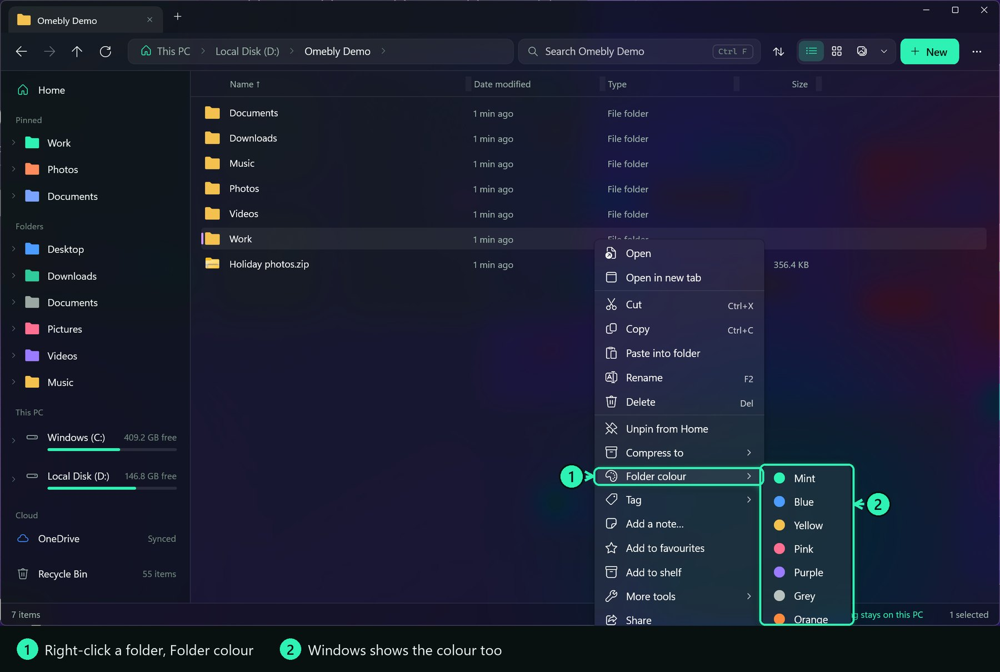</p>

- **Folder colours:** right-click a folder, **Folder colour**, and pick one. Windows' own File Explorer and the Open and Save windows show the colour too.

<p align="center">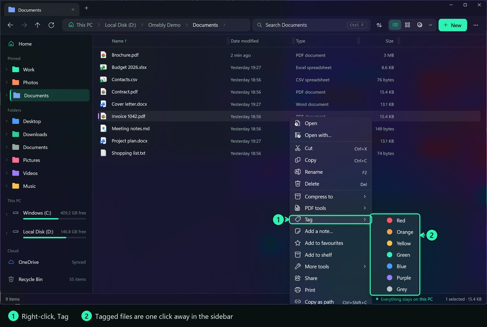</p>

- **Tags:** right-click any file, **Tag**, and pick a colour. Click a tag in the sidebar to see every file with it, from every folder.
- **Notes:** right-click, **Add a note**, to keep a short note on any file or folder. Hover over it to read the note.
- **Favourites:** files you use all the time, in the sidebar.
- **The shelf:** a holding place for files you're gathering from different folders. Add files to it, then copy or move them all at once.
- **Templates:** save a folder's set of folders (for example *Client > Invoices, Photos, Contracts*) as a template, then **New from template** makes the same set anywhere in one click.
- **Tidy up:** sorts a messy folder (such as Downloads) into Pictures, Documents, Videos and other subfolders, and Undo puts it all back.

### 12. Renaming many files at once

Select several files and press **F2**.

<p align="center">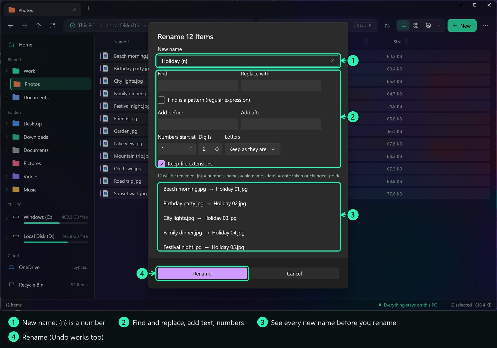</p>

1. **New name:** for example `Holiday {n}` gives *Holiday 01, Holiday 02, …*. `{name}` keeps the old name, `{date}` adds the date the photo was taken (or the date changed), and `{folder}` adds the folder's name.
2. **More ways:** find and replace (also with patterns), add text before or after, choose where the numbers start and how many digits they have, and change the letters to UPPER, lower or Title case.
3. **Preview:** every new name is shown before anything changes.
4. **Rename.** Changed your mind? **Ctrl+Z**.

### 13. Tools

Open **⋯ > Tools** (or **Ctrl+K**, then "Tools").

<p align="center">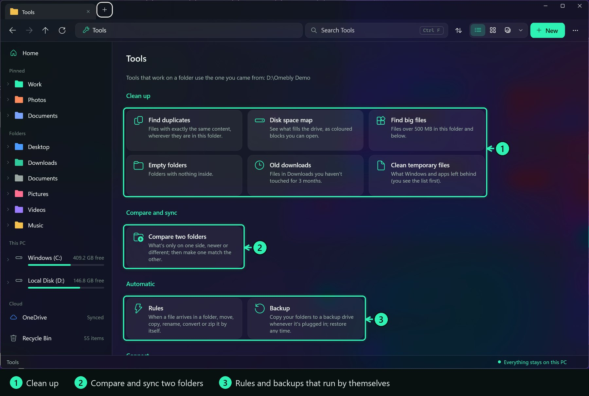</p>

**Find duplicates:** right-click a folder, then **More tools > Find duplicates in this folder**. Files with exactly the same content are found by a fingerprint, whatever their names. The oldest copy is kept, and the others are ticked so they can go to the Recycle Bin in one click.

<p align="center">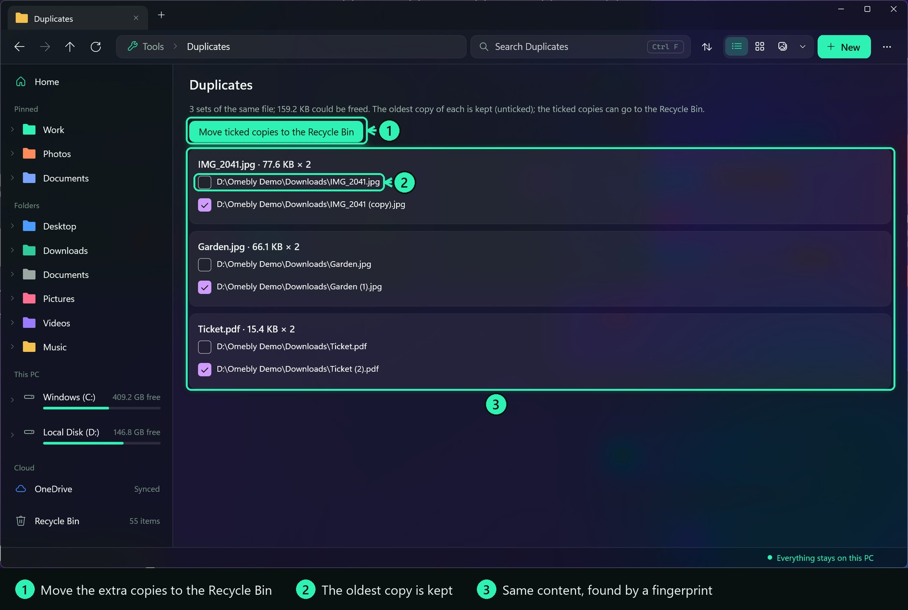</p>

**Disk space map:** see what fills a drive or folder. The bigger the block, the bigger the file or folder. Click a block to look inside it, and right-click to open it.

<p align="center">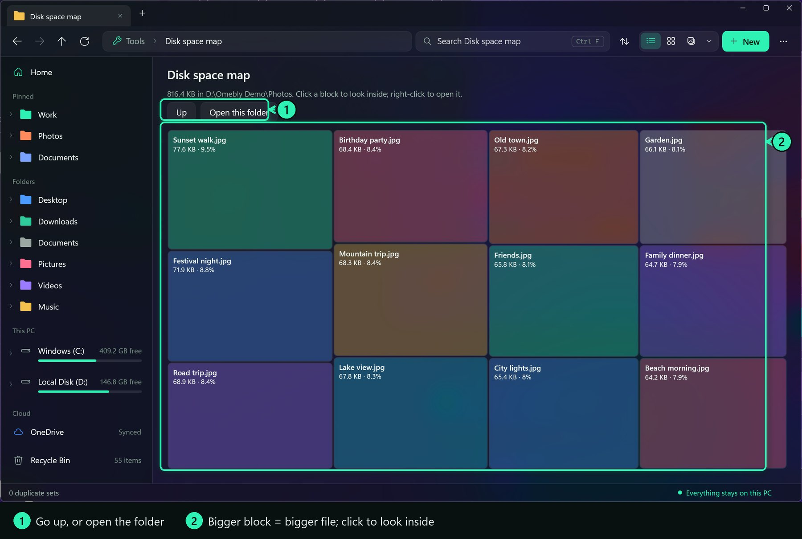</p>

The other tools:

- **Find big files:** files over 500 MB.
- **Empty folders:** folders with nothing inside.
- **Old downloads:** files in Downloads you haven't touched for 3 months.
- **Clean temporary files:** what Windows and apps leave behind. You see the list first.
- **Compare two folders:** shows what's only on one side, newer or different, then makes one folder match the other.
- **Rules:** when a file arrives in a folder, move, copy, rename, convert or zip it by itself. For example, move every PDF in Downloads to Documents.
- **Backup:** copy your folders to a USB or backup drive every time it's plugged in. Older versions are kept, and you can restore any of them.
- **Start-up apps:** see and turn off the apps that start with Windows.

### 14. More tools: lock, shred, permissions

<p align="center">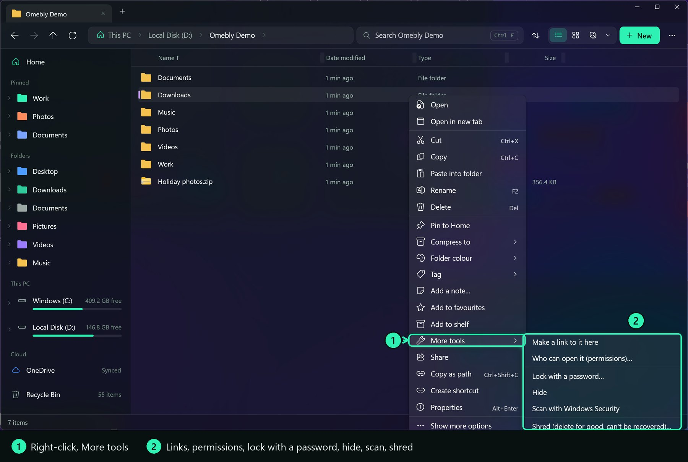</p>

- **Lock with a password:** the file is encrypted with AES-256. Only the password opens it, so don't forget it.
- **Shred:** deletes a file for good, so it can't be recovered. It asks twice.
- **Who can open it:** a file's permissions, in plain words.
- **Make a link to it here:** a link (symbolic link) that looks like the file but takes no space.
- **Hide or unhide**, and **scan with Windows Security**.
- **What is using this file?** When Windows says a file "is open in another program", Omebly tells you which one.
- **Checksums:** MD5, SHA-1 and SHA-256, to check a download.
- **Photo privacy:** remove the location and camera details from photos before you share them.

### 15. Preview pane and split view

<p align="center">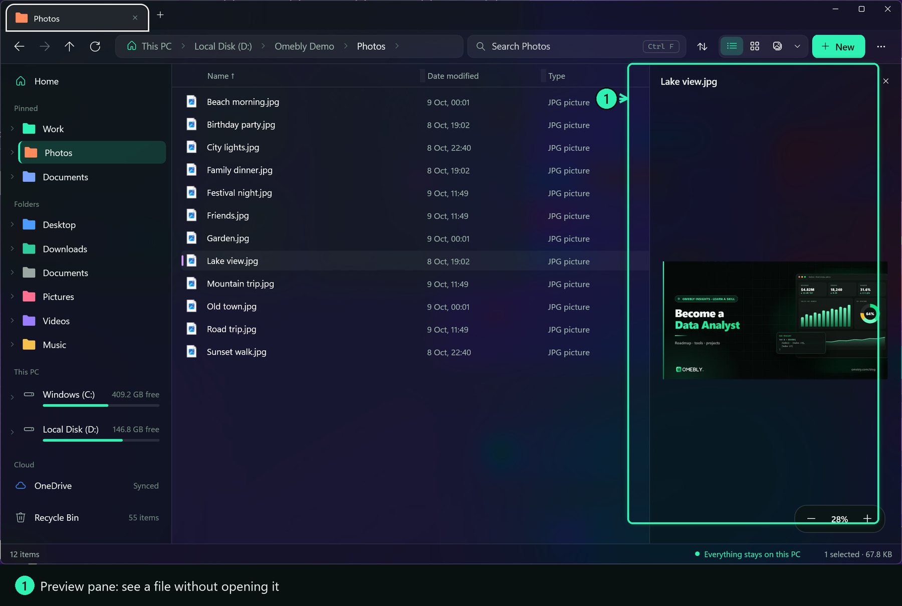</p>

- **Preview pane (Alt+P):** see the selected file on the right without opening it. **Alt+Shift+P** shows the details pane instead (size, dates, dimensions, and so on, which you can edit).
- **Split view:** two folders side by side, for dragging files between them. Use **Ctrl+K > Split view**, or **All views > Split view**.

<p align="center">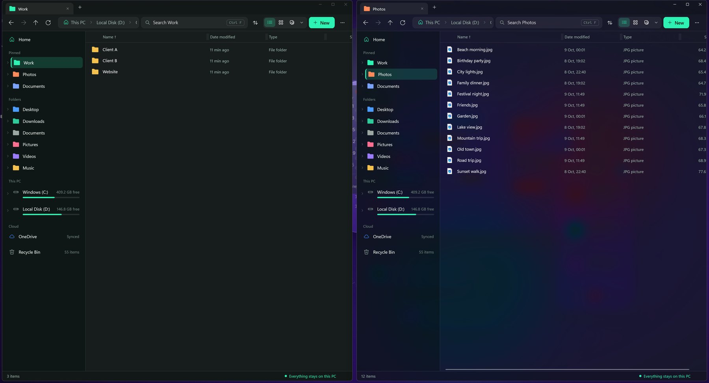</p>

### 16. Cloud drives, phones and servers

- **OneDrive, Google Drive, Dropbox and iCloud:** shown in the sidebar with each file's sync status. Right-click and choose **Always keep on this device** or **Free up space**.
- **Phones and cameras:** plug in with USB, and they show up under This PC. Copy photos off them like from any folder.
- **Network drives:** **Map a network drive** is on the This PC menu.
- **FTP, FTPS and SFTP servers:** add a server once, and it shows up in the sidebar like a folder. Passwords are kept in Windows Credential Manager, never in a file.

### 17. Make Omebly your default file manager

<p align="center">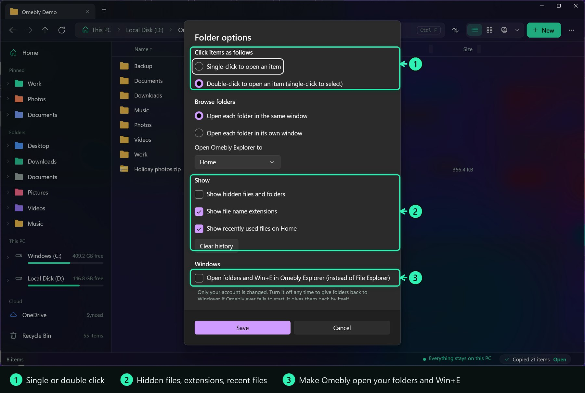</p>

Open **⋯ > Folder options** and tick **Open folders and Win+E in Omebly Explorer** (3). From then on, folders you open from the desktop, from other apps, and with **Win+E** open in Omebly. Only your account is changed. Untick it any time to give folders back to File Explorer, and if Omebly ever fails to start, it gives them back by itself.

**Jump-to bar:** turn it on in the same window. While Omebly Explorer is open, every app's **Open** and **Save** window (Photoshop, Chrome, Word, and so on) gets a small bar with your pinned folders and the folder open in Omebly, one click away.

### 18. Themes

Two looks: **Omebly Glass** (dark, see-through) and **Windows Light**. Change it in **⋯ > Theme** or with **Ctrl+K**.

<p align="center">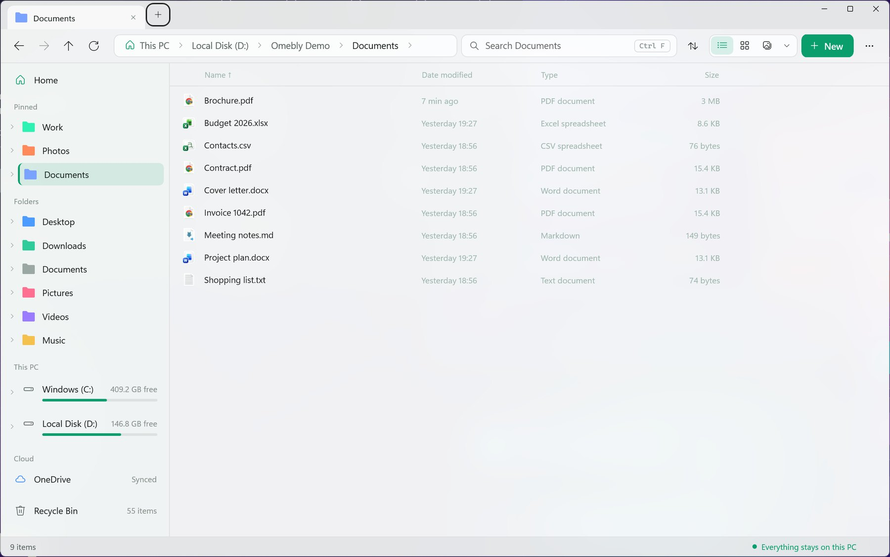</p>

### 19. Updates

When a new version is out, Omebly Explorer shows **Update Omebly Explorer** when it opens. Click **Update now**: it downloads the update, checks that it really comes from Omebly (it's signed), installs it and opens again by itself. Your settings, pins and tags stay. You can also check any time in **⋯ > About > Check for updates**.

---

## Keyboard shortcuts

| Keys | What they do | Keys | What they do |
|---|---|---|---|
| **Ctrl+T** | New tab | **Ctrl+W** | Close tab |
| **Ctrl+Shift+T** | Reopen the closed tab | **Ctrl+Tab** | Next tab |
| **Ctrl+N** | New window | **Ctrl+Shift+N** | New folder |
| **Ctrl+L** / **Alt+D** | Type a path | **Ctrl+F** / **Ctrl+E** | Search |
| **Ctrl+K** | Command bar | **F5** | Refresh |
| **Alt+Left** / **Backspace** | Back | **Alt+Right** | Forward |
| **Alt+Up** | Up one folder | **Enter** | Open |
| **Space** | Quick look | **Esc** | Close the viewer |
| **F2** | Rename (several files: bulk rename) | **Alt+Enter** | Properties |
| **Ctrl+C / X / V** | Copy, cut, paste | **Ctrl+Shift+C** | Copy as path |
| **Del** | To the Recycle Bin | **Shift+Del** | Delete for good (asks) |
| **Ctrl+Z** | Undo | **Ctrl+Y** / **Ctrl+Shift+Z** | Redo |
| **Ctrl+A** | Select all | **Ctrl+mouse wheel** | Bigger or smaller icons |
| **Ctrl+1 / 2 / 3** | Details, Tiles, Gallery | **Ctrl+Shift+1…8** | Windows' views (icons to content) |
| **Alt+P** | Preview pane | **Alt+Shift+P** | Details pane |

In the viewer: **← →** previous and next, **+ −** zoom, **R** rotate, **0** fit, **F** full screen, **E** edit text, **Ctrl+S** save, and **Ctrl+Page Down/Up** next or previous file.

---

## Privacy and safety

- **Nothing leaves your PC.** There's no account, no upload, no tracking, no ads and no open ports. The only time it goes online is to check for a new version, and that check sends nothing about you.
- **Signed updates.** Updates are signed with Omebly's key (ECDSA P-256), and the installer's SHA-256 fingerprint is checked before anything runs, so a fake update can't get in.
- **Normal rights.** It runs with your normal rights, never as admin.
- **Careful with deleting.** Deletes go to the Recycle Bin, and shredding asks twice.
- **Safe archives.** Archives can't write outside the folder you chose, and zip bombs are stopped.
- **Passwords and locked files.** Server passwords stay in Windows Credential Manager, and locked files use AES-256-GCM.
- **Crash details stay with you.** If the app ever crashes, the details are written to `%LOCALAPPDATA%\Omebly\Explorer\crash.log` on your PC only. Nothing is sent.

---

## Questions

<details><summary><b>Is it really free?</b></summary>

Yes. It's free, with no ads, no account and no paid version, and it's open source under the MIT licence.
</details>

<details><summary><b>Why does Windows say "Windows protected your PC"?</b></summary>

Windows SmartScreen shows this for apps that are new and not yet downloaded by many people. Click **More info**, then **Run anyway**. It goes away as more people use the app.
</details>

<details><summary><b>Does it replace File Explorer?</b></summary>

Only if you want it to (see [part 17](#17-make-omebly-your-default-file-manager)). File Explorer stays on your PC, untouched, and you can switch back any time.
</details>

<details><summary><b>Do the PDF tools upload my files?</b></summary>

No. They run inside the app, on your PC, even with no internet connection.
</details>

<details><summary><b>Do I need Microsoft Office for the Word and Excel tools?</b></summary>

No. Every conversion is built in.
</details>

<details><summary><b>Which Windows versions does it work on?</b></summary>

Windows 11, and Windows 10 version 1809 or newer. There are installers for normal (x64) PCs and ARM PCs.
</details>

<details><summary><b>Where are my settings kept?</b></summary>

In `%LOCALAPPDATA%\Omebly\Explorer`. Uninstalling the app keeps them, so a reinstall picks up where you left off.
</details>

<details><summary><b>I found a bug, or I have an idea.</b></summary>

Please [open an issue](https://github.com/hussain5049/omebly-explorer/issues). If you like Omebly Explorer, a ⭐ on this page helps other people find it.
</details>

---

## Build it yourself

You need the .NET 10 SDK, the Windows 10 SDK (10.0.26100) and, for the installer, [Inno Setup 6](https://jrsoftware.org/isinfo.php) (free).

```
dotnet build src/OmeblyExplorer -c Release -p:Platform=x64
dotnet publish src/OmeblyExplorer -c Release -r win-x64 -p:Platform=x64 -o publish/x64      (also win-arm64 / ARM64)
iscc /DArch=x64 installer\OmeblyExplorer.iss
```

The PDF tools come from the [Omebly Tools](https://omebly.com/tools/) website build. `python tools/bundle-web-tools.py <website/dist>` copies them into `src/OmeblyExplorer/WebTools`.

**Tests**
- `tests/Checks` and `tests/EngineChecks`: the engine.
- `tests/UiTests`, `tests/ViewerTests`, `tests/ParityTests` and `tests/StageTests`: the real window, driven by mouse and keyboard, so run them on a PC nobody is using.
- `tests/webtools.ps1`: every PDF tool.
- `--selftest`: the built-in self-test.

The pictures in this guide are taken from the real app by `tests/Shots`, in a demo folder made by `tools/make-demo.py`, and marked up by `tools/annotate-guide.py`.

## Open-source parts

- WinUI 3 and the Windows App SDK (MIT)
- SharpCompress (MIT), SharpZipLib (MIT) and PDFsharp (MIT)
- FluentFTP (MIT) and SSH.NET (MIT)
- In the PDF tools: pdf.js (Apache 2.0), qpdf (Apache 2.0), Tesseract (Apache 2.0) and ONNX Runtime (MIT)
- FlaUI, for the tests (MIT)
- Ideas from the Files app (MIT)

## Licence

MIT. See [LICENSE](LICENSE). Made by [Omebly](https://omebly.com).
